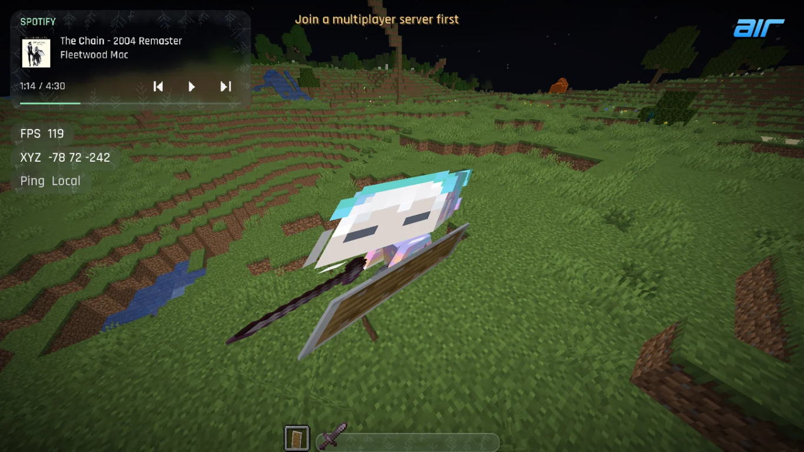
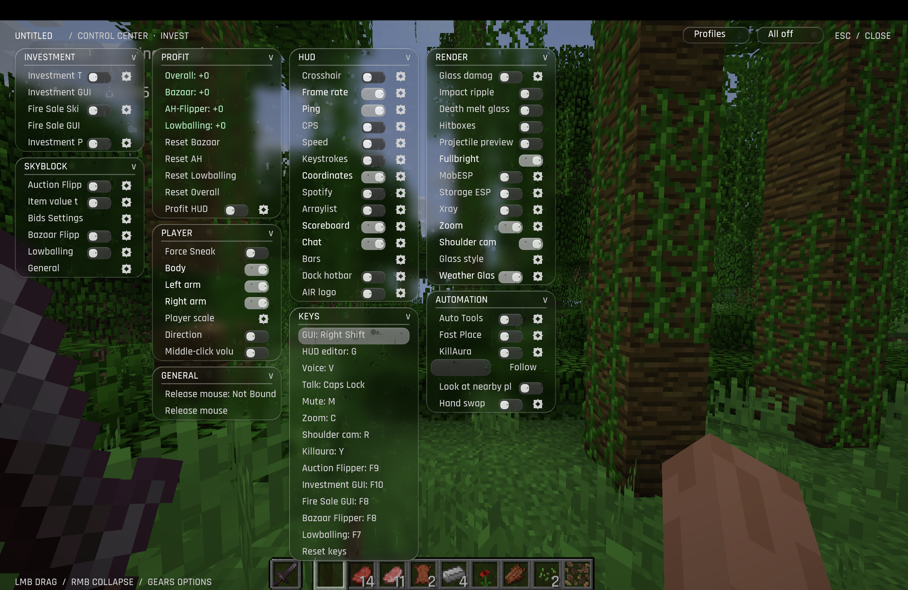
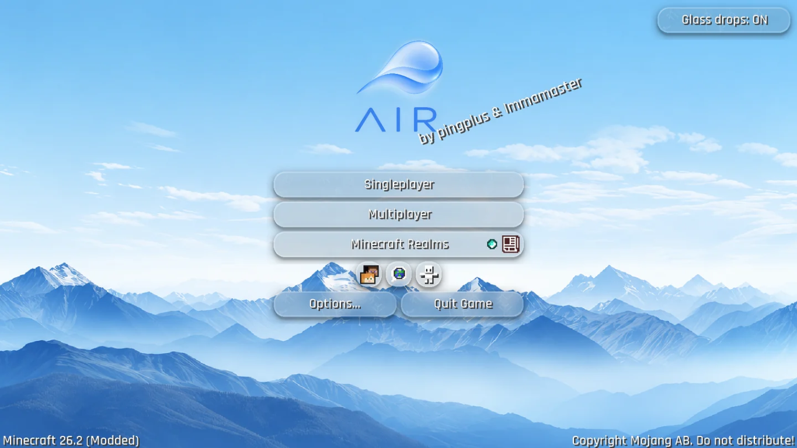

A Minecraft client with voice chat, Spotify, and a customizable liquid glass interface. It also includes experimental Bazaar and Auction House automation features, subject to the usage restrictions below.

## How to use

Build it yourself with **Java 25** using `./gradlew build` (`gradlew.bat build` on Windows), or [download the latest build here](https://github.com/AeroAlpine/Air-Client/releases).

1. Install **Fabric Loader 0.19.5+** for **Minecraft 26.2** with **Java 25+**.
2. Put the client JAR and **Fabric API** in your Minecraft instance's `mods` folder. For local builds, use `build/libs/Air-Client-0.2.4.jar`.
3. Launch the Fabric profile. Press **Right Shift** for client settings, **G** to edit the HUD, or **V** for voice chat settings.

The main menu shows the installed version and an **Update** button when a newer GitHub release is available. Download it there, then quit and relaunch Minecraft to apply it. See [updater and release instructions](docs/AUTO_UPDATER.md).

While the Bazaar flipper, AH flipper, bid macro, or lowballer is active, switching windows keeps it running. Escape releases the mouse without opening a blocking pause menu. Stop the bots with their toggle keys or **All off** to use the normal pause menu again.

Licensed under the [GNU Affero General Public License v3.0 (AGPL-3.0-only)](LICENSE).
See [NOTICE](NOTICE) for copyright and [THIRD_PARTY_NOTICES.md](THIRD_PARTY_NOTICES.md)
for bundled components. The Air Client name and logo are not covered by the AGPL.

## Usage disclaimer

Use this client at your own risk. Follow the rules and terms of every server you connect to.

Do not use automation or cheating features on the Hypixel network or on any server that prohibits them. Use the SkyBlock automation features only on private testing instances or independent servers that are unaffiliated with Hypixel and whose operators explicitly permit automation and the specific features you enable.

Air Client is not affiliated with or endorsed by Hypixel. This notice does not override server rules, applicable terms, or third-party rights.
